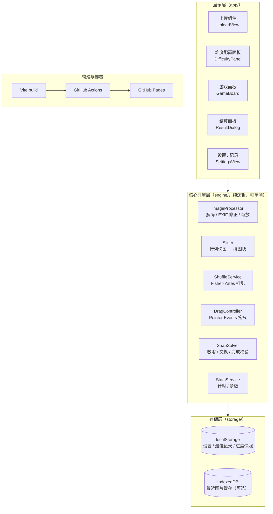
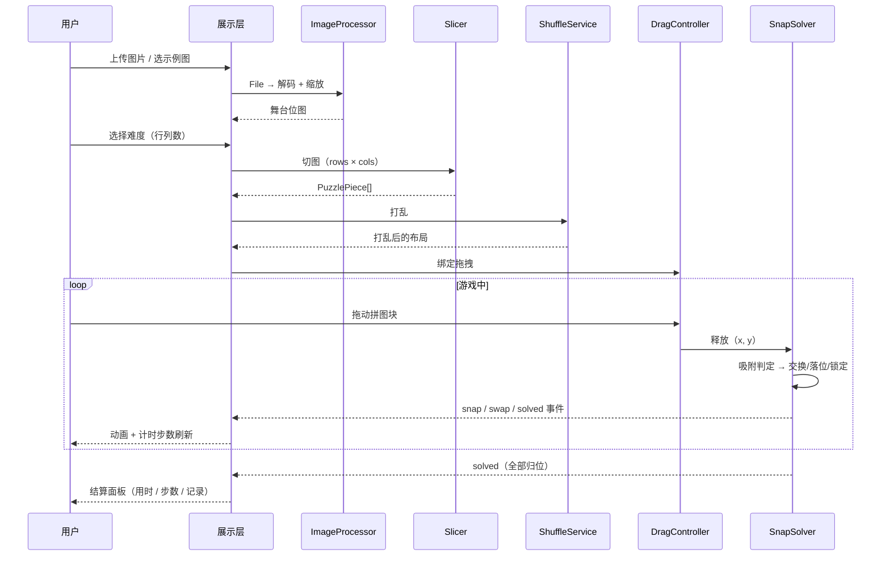
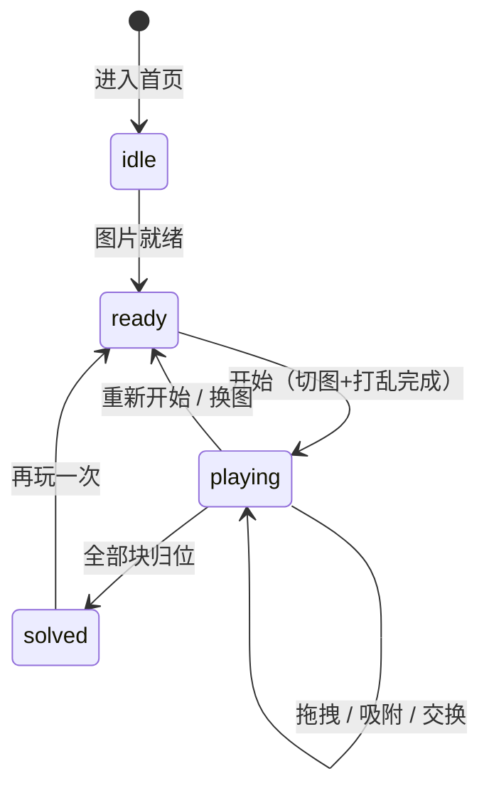

# TinyPuzzle 技术架构文档

| 项目 | 内容 |
|---|---|
| 文档版本 | v1.0 |
| 状态 | 已评审通过 |
| 仓库 | <https://github.com/514215834/TinyPuzzle> |
| 线上地址 | <https://514215834.github.io/TinyPuzzle/> |
| 关联文档 | [02-功能点迭代文档](./02-功能点迭代文档.md) |

---

## 1. 项目概述

### 1.1 背景与目标

TinyPuzzle 是一款**纯前端网页拼图游戏**：用户上传一张图片，游戏将其切割为指定数量的拼图块，用户通过拖拽完成拼图。

核心目标：

1. **上传即玩**：支持上传本地图片并根据图片生成拼图；
2. **难度可配**：支持配置拼图数量（预设档位 + 自定义行列）；
3. **零成本部署**：纯静态产物，直接部署在 GitHub Pages，无后端、无服务器费用；
4. **隐私安全**：图片全程在浏览器本地处理，**不上传任何服务器**。

### 1.2 约束条件

| 约束 | 说明 |
|---|---|
| 部署平台 | GitHub Pages（项目页，子路径 `/TinyPuzzle/`） |
| 服务端 | 无。所有计算（解码、切图、打乱、判定）在浏览器端完成 |
| 持久化 | 仅浏览器本地存储（localStorage / IndexedDB），无账号体系 |
| 访问协议 | 仅 HTTPS（Pages 默认） |

---

## 2. 总体架构

### 2.1 架构图



### 2.2 架构原则

1. **引擎与 UI 分离**：`engine/` 目录不依赖任何 DOM 渲染细节（仅 DragController 面向指针事件抽象），保证核心逻辑可用 Vitest 单测；
2. **渐进演进**：V0.1–V0.3 使用方块拼图 + 交换式玩法，V0.4 引入异形块与自由摆放模式，架构上通过 `PieceShape` 抽象预留，不做提前设计；
3. **零运行时依赖**：不引入框架与大型工具库，构建产物体积可控（见 §9 性能预算）。

---

## 3. 技术选型

| 层面 | 选型 | 理由 | 落选方案 |
|---|---|---|---|
| 构建工具 | Vite 5 | 冷启动快、产物纯静态、`base` 配置天然适配 Pages 子路径、开箱支持 TS | Webpack（配置重）；纯原生零构建（无类型检查、无压缩、开发体验差） |
| 语言 | TypeScript 5（strict） | 吸附/校验等核心逻辑类型安全，重构有保障 | JavaScript |
| UI 层 | 原生 DOM + CSS | 交互集中在拼图画布上，框架收益低；省去运行时体积 | Vue3 / React（对该规模项目过重） |
| 图形渲染 | Canvas API + CSS transform | 切片用离屏 canvas，块定位用 `translate3d`，兼顾性能与实现简单度 | 单一大 canvas 自绘（交互代码量大）；WebGL（收益不成比例） |
| 拖拽 | Pointer Events | 一套 API 统一鼠标 / 触控 / 笔，配合 `setPointerCapture` | 原生 Mouse/Touch 双轨（代码翻倍） |
| 本地存储 | localStorage + IndexedDB | 前者存小体积键值（设置/记录），后者存图片 Blob | 仅 localStorage（图片 Blob 超配额） |
| 单测 | Vitest | 与 Vite 同源配置，零额外成本 | Jest |
| PWA（V0.3） | vite-plugin-pwa | manifest + Service Worker 一站式 | 手写 SW |

---

## 4. 模块设计

### 4.1 目录结构

```
TinyPuzzle/
├─ .github/workflows/deploy.yml     # Pages 部署工作流
├─ docs/                            # 本文档与迭代文档
├─ public/
│  ├─ favicon.svg
│  ├─ samples/                      # 内置示例图（离线可玩）
│  └─ icons/                        # PWA 图标
├─ src/
│  ├─ main.ts                       # 入口，视图路由（极简 hash 切换）
│  ├─ app/                          # 展示层
│  │  ├─ views/                     # UploadView / GameView / ResultDialog
│  │  ├─ components/                # 难度面板、按钮等通用组件
│  │  └─ styles/
│  ├─ engine/                       # 核心引擎（纯逻辑，可单测）
│  │  ├─ types.ts                   # PuzzlePiece / GameState 等类型
│  │  ├─ imageProcessor.ts          # 图片解码、EXIF、缩放
│  │  ├─ slicer.ts                  # 行列切图
│  │  ├─ shuffle.ts                 # 打乱算法
│  │  ├─ dragController.ts          # 拖拽控制
│  │  ├─ snapSolver.ts              # 吸附 / 交换 / 完成校验
│  │  └─ stats.ts                   # 计时 / 步数
│  ├─ storage/
│  │  ├─ settings.ts                # 偏好设置
│  │  ├─ records.ts                 # 最佳记录
│  │  ├─ progress.ts                # 对局快照（V0.3）
│  │  └─ imageStore.ts              # IndexedDB 图片缓存（可选）
│  └─ utils/
├─ tests/                           # 引擎层单测
├─ index.html
├─ vite.config.ts
├─ tsconfig.json
└─ package.json
```

### 4.2 模块职责与关键接口

#### ImageProcessor（图片处理）

- 输入：`File` / `Blob`；
- 职责：`createImageBitmap(blob, { imageOrientation: 'from-image' })` 解码（自动修正 EXIF 方向）→ 按 §7.6 规则缩放至舞台渲染尺寸 → 输出离屏 `HTMLCanvasElement`；
- 边界：非图片文件、解码失败、超大图（> 4096px）均归一为「自动缩放」或「友好报错」。

#### Slicer（切图）

- 输入：舞台位图 + `rows` / `cols` + 玩法模式；
- 职责：将位图按行列等分，为每块生成独立切片（方块阶段用 `background-position` 共享底图；异形阶段导出每块独立 canvas）；
- 输出：`PuzzlePiece[]`。

#### ShuffleService（打乱）

- Fisher-Yates 随机置换；重试直到「打乱后 ≠ 完成态」且（可选）「无任何块位于原位」。

#### DragController（拖拽）

- 在棋盘容器上监听 `pointerdown / pointermove / pointerup`，`setPointerCapture` 锁定指针；
- 移动块采用 `transform: translate3d(x, y, 0)` 定位，避免布局重排；
- 容器 CSS `touch-action: none`，杜绝移动端滚动/双击缩放干扰。

#### SnapSolver（吸附与判定）

- 释放时计算块中心与最近目标格中心距离，小于阈值 `0.35 × min(cellW, cellH)` 则吸附；
- 吸附后按 §7.5 规则处理交换 / 锁定 / 完成校验，并发出事件（`snap` / `swap` / `solved`）供 UI 层播放动画与音效。

#### StatsService（统计）

- 基于 `performance.now()` 计时；`document.visibilitychange` 隐藏时自动暂停计时（防挂机计时膨胀）；
- 每次有效交换步数 +1。

---

## 5. 核心流程

### 5.1 一局游戏主流程



### 5.2 对局状态机



---

## 6. 数据结构与状态设计

```typescript
/** 拼图块 */
interface PuzzlePiece {
  id: number;              // 原始位置索引：row * cols + col（即正确落点）
  row: number;             // 目标行
  col: number;             // 目标列
  cellIndex: number;       // 当前所在格（打乱后 ≠ id）
  x: number;               // 当前渲染坐标（px，相对棋盘）
  y: number;
  locked: boolean;         // 已吸附在正确位置并锁定
  zIndex: number;          // 拖拽时置顶
  shape?: PieceShape;      // V0.4 异形边路径
}

/** 一局对局状态 */
interface GameState {
  status: 'idle' | 'ready' | 'playing' | 'solved';
  imageRef: string;        // 示例图路径 或 IndexedDB 图片 id
  rows: number;
  cols: number;
  pieces: PuzzlePiece[];
  moves: number;           // 有效交换次数
  startedAt: number;       // 时间戳
  elapsedMs: number;       // 累计用时（支持暂停）
  mode: 'swap' | 'free';   // 交换式 / 自由摆放（V0.4）
}

/** 事件（SnapSolver / DragController → UI） */
type GameEvent =
  | { type: 'pick'; pieceId: number }
  | { type: 'snap'; pieceId: number; correct: boolean }
  | { type: 'swap'; a: number; b: number }
  | { type: 'solved' };
```

---

## 7. 关键技术方案

### 7.1 拼图数量配置

- **预设档位**：`9 / 16 / 25 / 36 / 64 / 100`（对应 3×3 ~ 10×10），带难度文案（入门 / 简单 / 中等 / 困难 / 大师 / 地狱）；
- **自定义**：行 × 列独立选择，范围 2 ~ 10，块数 = 行 × 列（2×10、10×2 等长条布局合法）；
- 配置变更即时反映在「预览缩略图」上（打网格线预览），确认后开始切图。

### 7.2 渲染方案（渐进）

| 阶段 | 方案 | 说明 |
|---|---|---|
| 方块拼图（V0.1–V0.3） | 每块一个 `div`，背景为整图 + `background-position` 偏移 | 零切片成本、缩放窗口只需改偏移量，实现最简单 |
| 异形拼图（V0.4） | 每块独立离屏 canvas 切片 + CSS `clip-path` / 路径模板 | 相邻边凹凸互补，凸起区域按路径绘制 |

拖拽定位统一使用 `transform: translate3d` + `will-change: transform`，锁定块 `z-index: 0` 且移出交互层。

### 7.3 拖拽与移动端

```typescript
board.addEventListener('pointerdown', (e) => {
  const piece = hitTest(e);            // 命中未锁定块
  piece.el.setPointerCapture(e.pointerId); // 后续 move/up 都派发给该元素
});
```

- 命中测试按 `z-index` 从高到低遍历（避免只命中顶层元素下的空白区）；
- `touch-action: none` + 阻止 `contextmenu`（长按菜单）；
- 触控目标≥ 44×44px；小尺寸块（100 块档）允许拖拽命中半径外扩 8px。

### 7.4 打乱算法

```typescript
function shuffle(n: number, rng = Math.random): number[] {
  const arr = Array.from({ length: n }, (_, i) => i);
  for (let i = n - 1; i > 0; i--) {
    const j = Math.floor(rng() * (i + 1));
    [arr[i], arr[j]] = [arr[j], arr[i]];
  }
  return arr; // arr[cellIndex] = pieceId
}
```

- 循环重试直至「非完成态」；难度 ≤ 9 块时额外要求「无一块在原位」；
- 交换式玩法下任意置换均可通过交换还原，**无需奇偶性校验**（区别于华容道/15puzzle 类游戏）。

### 7.5 吸附、交换与完成判定

释放时的判定顺序：

1. 计算与最近目标格中心距离，超过阈值 → 弹回原格（150ms 缓动）；
2. 目标格为空 → 直接落位；
3. 目标格已有其他块（未锁定）→ **两块互换**；
4. 目标格块已锁定 → 视为无效落点，弹回；
5. 落位后若 `cellIndex === id` → 标记 `locked`，置底（`z-index: 0`），播放正确音效；
6. 全部块 `locked` → 发出 `solved`，停表，进入结算。

### 7.6 大图处理与性能

- 解码：`createImageBitmap(blob, { imageOrientation: 'from-image' })`，Safari 低版本降级为 `Image` + `decode()`；
- 缩放：按舞台渲染尺寸（最长边 ≤ 1024px）等比**居中裁剪（cover）**到目标比例，既保证棋盘满铺无黑边，又把内存占用限制在 ~4MB 位图以内；
- 切图在 `requestIdleCallback` / 分帧中完成，避免 100 块时主线程长任务；
- 大图上传不阻塞 UI：解码本身在浏览器内部线程完成。

### 7.7 玩法模式扩展（V0.4 预留）

- `swap`（交换式，V0.1 起）与 `free`（自由摆放：块散落托盘区，仅能吸附到**正确**格）共用同一 `PuzzlePiece` 模型，仅 SnapSolver 策略不同；
- 异形块路径：以经典 jigsaw 凹凸边为模板，相邻边共享一条贝塞尔曲线（一凸一凹互补），随机翻转方向避免规律感。

---

## 8. 存储设计

### 8.1 localStorage

| Key | 内容 | 写入时机 |
|---|---|---|
| `tp.settings` | `{ soundOn, hintOpacity, lockOnSnap, difficulty, lang }` | 设置变更 |
| `tp.records` | `{ "r-c": [{ time, moves, at }] }` 按行列分档的最佳记录 | 刷新纪录 |
| `tp.progress` | 对局快照：布局、步数、用时（图片本体不存此处） | 每次落位（节流） |

### 8.2 IndexedDB（可选，V0.3）

- 库 `tinypuzzle`，对象仓库 `images`：`{ id, blob, thumb(dataURL), createdAt }`；
- 仅缓存**最近 5 张**用户上传图，用于「继续上次拼图」与刷新恢复；提供「清除本地数据」入口；
- 不上传服务器，仅在用户主动上传时写入本地库。

---

## 9. 部署方案（GitHub Pages）

### 9.1 前提

| 项 | 值 |
|---|---|
| 仓库 | `514215834/TinyPuzzle` |
| Pages 类型 | **GitHub Actions**（Source 选择 "GitHub Actions"，见 9.3） |
| 访问地址 | `https://514215834.github.io/TinyPuzzle/` |
| Vite base | `/TinyPuzzle/`（**必须**，否则资源 404；若未来迁移到 `514215834.github.io` 仓库则改为 `'/'`） |

### 9.2 构建配置

```typescript
// vite.config.ts
import { defineConfig } from 'vite';

export default defineConfig({
  base: '/TinyPuzzle/',            // 项目页子路径
  build: {
    target: 'es2019',
    outDir: 'dist',
  },
});
```

单页应用、无前端路由 → **无需** 404 fallback；静态资源文件名带内容 hash，Pages 默认 10 分钟缓存即可保证更新可见。

### 9.3 部署工作流（`.github/workflows/deploy.yml`）

```yaml
name: Deploy to GitHub Pages

on:
  push:
    branches: [main]        # 若默认分支为 master，请改为 master
  workflow_dispatch:

permissions:
  contents: read
  pages: write
  id-token: write

concurrency:
  group: pages
  cancel-in-progress: true

jobs:
  build:
    runs-on: ubuntu-latest
    steps:
      - uses: actions/checkout@v4
      - uses: actions/setup-node@v4
        with:
          node-version: 20
          cache: npm
      - run: npm ci
      - run: npm run build
      - uses: actions/upload-pages-artifact@v3
        with:
          path: dist

  deploy:
    needs: build
    runs-on: ubuntu-latest
    environment:
      name: github-pages
      url: ${{ steps.deployment.outputs.page_url }}
    steps:
      - id: deployment
        uses: actions/deploy-pages@v4
```

### 9.4 仓库设置步骤

1. 仓库 **Settings → Pages → Build and deployment → Source** 选择 **GitHub Actions**；
2. 推送到 `main` 分支即自动构建部署；Actions 面板可查看进度；
3. 部署失败回滚：Actions 页面 rerun 上一次成功的工作流，或 revert 对应 commit。

---

## 10. 性能与兼容性

### 10.1 性能预算

| 指标 | 目标 |
|---|---|
| 首屏 JS（gzip） | ≤ 80KB（无框架，仅业务代码） |
| 首次可玩时间（4G） | ≤ 2s |
| 拖拽帧率 | 60fps（100 块时无掉帧） |
| 切图耗时（1024px 图） | ≤ 300ms |
| 内存峰值 | ≤ 150MB（含位图） |

### 10.2 浏览器支持

| 浏览器 | 版本 | 依据 |
|---|---|---|
| Chrome / Edge | ≥ 88 | Pointer Events、createImageBitmap |
| Firefox | ≥ 90 | 同上 |
| Safari | ≥ 15 | createImageBitmap 支持（低版本走降级路径） |
| 移动端 | iOS Safari 15+ / Android Chrome 90+ | 触控优先适配 |

不支持 IE；JS 目标 es2019。

---

## 11. 安全与隐私

1. **图片不出浏览器**：无网络上传代码，无第三方统计/CDN 依赖（除 GitHub Pages 本身）；
2. **无用户数据采集**：不收集任何个人信息，记录仅存本地；
3. **输入校验**：上传仅接受 `image/png|jpeg|webp` MIME，解码失败即拒绝，防止异常文件导致崩溃；
4. **依赖安全**：运行时零依赖，构建期依赖定期 `npm audit`。

---

## 12. 风险与对策

| 风险 | 影响 | 对策 |
|---|---|---|
| 用户上传超大图（>20MB） | 解码慢、内存高 | 先 `createImageBitmap` 缩放再使用；进度提示；超限时引导压缩 |
| 移动端 Safari 触控滚动冲突 | 拖拽时页面滚动 | `touch-action: none` + `preventDefault` |
| Pages 子路径部署资源 404 | 白屏 | `base: '/TinyPuzzle/'` 上线前走「部署冒烟检查」 |
| 100 块拖拽掉帧 | 体验差 | transform 合成层定位、命中测试 O(1) 网格索引、分帧切图 |
| localStorage 配额写满 | 进度保存失败 | try/catch 静默降级 + 提示清理 |
| 浏览器刷新丢局 | 体验差 | V0.3 进度快照（§8） |

---

## 13. 术语表

| 术语 | 定义 |
|---|---|
| 舞台（Stage） | 拼图游玩区域的渲染尺寸（位图实际像素），区别于 CSS 显示尺寸 |
| 交换式（swap） | 拼图块拖到已占用格时与该块互换位置的玩法 |
| 自由摆放（free） | 拼图块散落托盘，仅可吸附到正确格的玩法（V0.4） |
| 锁定（locked） | 块位于正确格后置底且不可再拖动 |
| 异形块 | 带凹凸边的经典拼图形状（V0.4） |
